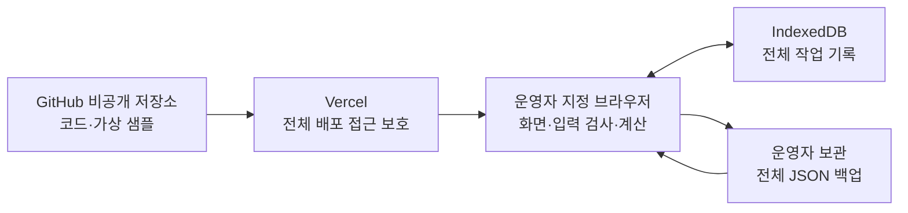

# 카페 판매·수익·재고 관리 기술 요구사항 문서(TRD)

- 작성일: 2026-10-12
- 상태: 1차 구현 기술 설계. 코드·저장소·배포는 아직 생성하지 않았다.
- TRD란: 기능을 어떤 기술과 구조로 만들고, 자료를 어디에 보관하며, 오류가 생기면 어떻게 보호할지 정한 문서다.
- 기준: `docs/01_PRD.md`, `docs/02_FRD.md`, `design/_1~_5/code.html`·`screen.png`, `design/fidelity_refined/DESIGN.md`, `date/`의 가상 매장 자료.
- 사용자 지정: 완성 코드는 GitHub에 보관하고 Vercel에 배포한다. 한 매장·한 운영자·지정 한 기기·비공개 사용 범위는 유지한다.
- 기능·순서·계산 기준은 FRD F01~F12·C01~C12를 따른다. 기술적인 편의 때문에 기준을 바꾸지 않는다.

## 1. 구현 방향

**React·TypeScript·Vite로 화면을 만들고, 계산과 운영 자료 저장은 운영자의 브라우저에서 처리한다. GitHub에는 코드와 가상 샘플을 보관하고, Vercel은 보호된 프로그램 화면을 전달한다. 실제 판매·비용 기록과 백업은 두 서비스로 전송하지 않는다.**

- React는 화면을 작은 공통 부품으로 만드는 도구다. TypeScript는 날짜·금액·메뉴 등의 자료 종류를 구분하여 잘못 연결하는 실수를 줄인다.
- Vite는 개발 화면을 실행하고 배포할 정적 파일을 만드는 도구다. 이 구성은 [React의 공식 시작 안내](https://react.dev/learn/build-a-react-app-from-scratch)와 [Vercel의 Vite 지원 안내](https://vercel.com/docs/frameworks/frontend/vite)를 기준으로 선택했다.
- IndexedDB는 브라우저 안의 기록 보관함이다. 서버 데이터베이스·자료 업로드 API·클라우드 동기화는 1차에 만들지 않는다.
- 백업 파일은 별도의 전체 기록 사본이다. GitHub의 코드 이력이나 Vercel의 배포 이력은 매장 기록 백업을 대신하지 않는다.
- Vercel 배포는 사용 범위를 여러 기기로 넓히는 결정이 아니다. 지정 브라우저의 자료는 다른 기기·브라우저에 자동 전달되지 않는다.

위 그림의 매장 기록 경로는 브라우저와 파일 사이에만 있다. Vercel에는 프로그램 파일을 요청하는 접근 정보가 전달되지만 판매·비용의 내용은 전송하지 않는다.

## 2. 선택 기술과 적용 범위

| 부분 | 선택 | 적용 방법·선택 이유 |
| --- | --- | --- |
| 화면 | React·TypeScript | 5개 화면과 공통 판매·비용 입력창 구성. 서버가 필요하지 않은 첫 버전에 적합 |
| 실행·배포 파일 생성 | Vite, Node.js 24.x LTS, npm | 같은 Node 주버전을 개발·자동 검사·Vercel 빌드에 사용. [Vercel은 Node 24 빌드를 지원](https://vercel.com/changelog/node-js-24-lts-is-now-generally-available-for-builds-and-functions) |
| 화면 스타일 | CSS Modules·CSS 변수 | 시안의 색상·간격·글자 규칙을 공통 변수로 구현. 시안의 외부 Tailwind 실행 스크립트는 사용하지 않음 |
| 화면 이동 | 앱 내부 상태와 해시 주소 | `/#/sales`, `/#/profit`, `/#/menus`, `/#/expenses`, `/#/inventory`. 같은 사이트 주소 안에서 화면을 바꾸며 새로 열기도 지원 |
| 입력·복원 검사 | Zod | 입력 폼·백업 파일·처음 자료에 같은 형식 검사를 적용. [Zod 공식 문서](https://zod.dev/) |
| 소수·금액 계산 | decimal.js | FRD의 원가 소수 보존·원 단위 반올림을 한 곳에서 처리. [공식 API](https://mikemcl.github.io/decimal.js/) |
| 기록 저장 | IndexedDB + idb | 기록별 저장과 여러 묶음의 전체 교체를 한 작업 단위로 처리. idb는 IndexedDB를 간단히 호출하는 보조 도구. [IndexedDB 안내](https://developer.mozilla.org/en-US/docs/Web/API/IndexedDB_API), [idb 안내](https://github.com/jakearchibald/idb) |
| 간단한 차트 | SVG | FRD의 일별 흐름·채널 비중만 표현. 사분면·전망 차트나 별도 분석 기능은 추가하지 않음 |
| 파일 | 브라우저 File·Blob·다운로드 기능 | 운영자 기기에서 JSON을 읽고 전체 백업 파일 생성. 서버로 업로드하지 않음 |
| 파일 손상 확인 | Web Crypto SHA-256 | 백업 내용의 검사값을 비교. 인증 서명·암호화와는 다른 역할. [digest 안내](https://developer.mozilla.org/en-US/docs/Web/API/SubtleCrypto/digest) |
| 자동 검사 | Vitest, fake-indexeddb | FRD 계산·자료 검사·저장 실패·전체 복원 검증. [Vitest 안내](https://vitest.dev/guide/), [모의 IndexedDB 안내](https://github.com/dumbmatter/fakeIndexedDB) |
| 코드 보관·검사 실행 | GitHub 비공개 저장소·GitHub Actions | 소스·문서·의존성 잠금 파일·가상 테스트 자료를 보관하고 검사 |
| 프로그램 배포 | Vercel 정적 배포 | `npm run build` 결과 `dist`를 전달. 운영 기록을 Vercel 파일이나 실행 서버에 저장하지 않음 |

각 패키지는 구현 시작 시 위 구성과 호환되는 안정 버전을 선택해 정확한 버전을 `package-lock.json`에 고정한다. 이후에는 `npm ci`로 같은 구성을 설치한다. 문서 작성 시점에 설치·실행한 것으로 주장하지 않는다. Node 24는 [Vite의 Node 요구사항](https://vite.dev/guide/)도 만족한다.

## 3. 프로그램 구성과 시안 적용

### 3.1 개발 파일 구성

아래는 앞으로 만들 구조이며 현재 코드가 존재한다는 뜻은 아니다.

| 위치 | 책임 |
| --- | --- |
| `src/app/` | 공통 화면 틀, 5개 화면 이동, 기간 선택, 저장 상태 |
| `src/pages/` | 기간 손익·판매·메뉴 수익성·비용·재료 조회 |
| `src/components/` | 판매·비용 입력창, 확인창, 표·지표·날짜 선택 |
| `src/domain/` | 자료 종류, FRD 계산, 가격·레시피 조회, 미확인 상태 |
| `src/services/` | 최초 자료 준비, 판매·비용 저장, 백업·복원 순서 |
| `src/storage/` | IndexedDB 연결, 작업 단위 저장, 자료 형식 갱신 |
| `src/validation/` | 필수값·연결 관계·날짜·단위·백업 검사 |
| `src/styles/` | 시안 색상·글자·간격과 화면별 스타일 |
| `public/sample/` | 제공 자료에서 준비한 가상 샘플 JSON 한 개 |
| `tests/` | 계산·변경·백업·복원의 대표 검사 자료 |
| `docs/` | PRD·FRD·TRD·개발 시 남기는 검사 결과 |

화면에서 직접 금액 계산·자료 저장을 하지 않는다. 계산은 `domain`, 저장은 `storage`, 순서 관리는 `services`를 거친다. 어떤 화면에서 판매를 추가해도 같은 처리 경로를 사용한다.

### 3.2 시안과 화면 연결

| 시안 | 구현 |
| --- | --- |
| _1 기간 실적·손익 | F02·F08. 판매·비용 추가는 공통 입력창, 최근 판매는 F03, 부족 안내는 F09의 결과 사용 |
| _2 비용 관리·입력창 | F07. 월 자동 배분·임시저장·증빙·부가세 자동 처리 등 FRD 제외 항목은 표시하지 않음 |
| _3 메뉴 수익성 | F06. 실제 등록 메뉴·기록 기반 표와 합계. 등급·사분면·전략 제언·엑셀 받기·매핑 설정 제외 |
| _4 잔량·실사·백업·복원 | F09·F11·F12. 발주·배송·미래 고갈·안전재고 미달 경고·무손실 문구 제외 |
| _5 판매 관리·입력창 | F03~F05. 수정·삭제를 실제 작업으로 연결. 고정 수수료 3%·샘플에 없는 메뉴·재료 제거 |

전체 스타일은 시안의 어두운 배경과 색상·간격을 사용하되 숫자 잘림·입력창 잘림을 방지한다. 긴 표에는 가로 스크롤, 금액에는 단위와 오른쪽 정렬을 사용한다. 필수 입력·오류는 색뿐 아니라 문구로 표시하고 키보드로 버튼·입력창을 사용할 수 있게 한다.

글꼴·아이콘은 라이선스를 확인한 파일을 앱과 함께 제공한다. 준비가 안 된 글꼴은 같은 계열의 시스템 글꼴로 대체한다. 시안의 외부 프로필 이미지·폰트·CDN 스크립트 요청은 가져오지 않는다. 프로필 이미지를 로그인·직원 관리 기능으로 확대하지 않는다.

## 4. 기록 저장 구조

### 4.1 원본과 계산 결과

운영 기록은 원본·사용자 정정값을 저장하고, 합계·잔량·비율은 그 기록에서 계산한다. 계산 잔량을 저장한 뒤 판매 저장 때 또 차감하는 구조를 사용하지 않는다. 판매 삭제·정정 때도 전체 근거 기록에서 같은 계산을 다시 적용한다.

| 기록 묶음 | 저장할 주요 값 | 1차 편집 |
| --- | --- | --- |
| 자료정보·작업정보 | 매장·출처·자료기간·앱 형식 버전·계산 버전·작업 개정번호 | 시스템 관리 |
| 메뉴·재료·공급사 | 원래 ID·이름·분류·단위·구매용량·가격·납기·안전재고 영업일 | 없음 |
| 레시피·가격이력 | 메뉴·재료·버전·수량·채널 제한, 재료·적용일·구매가격·용량 | 없음 |
| 영업달력 | 날짜·영업여부·마감여부·날씨·메모 | 없음 |
| 판매 | ID·일자·메뉴·채널·수량·당시 단가·할인·순매출·수수료·레시피버전·개당 원가·금액 입력 근거 | 추가·수정·삭제 |
| 비용 | ID·귀속일·분류·금액·기존 배분기준 | 추가·수정·삭제 |
| 초기재고 | 재료ID·기준일·수량·단위 | 없음 |
| 재고기록 | ID·날짜·재료·유형·부호 있는 수량·단위·사유·입고원가·공급사·실측수량 | 없음 |
| 월비용계획 | 월·분류·계획금액 | 없음 |

날짜는 `YYYY-MM-DD`, 귀속월은 `YYYY-MM`로 저장한다. 날짜만 있는 기록을 시간대가 있는 시각으로 바꾸지 않는다. 백업 생성시각 등 실제 시각은 ISO 형식으로 저장하고 한국 시간으로 표시한다.

원가·수량 등 소수 값은 내부 계산과 백업에서 손실 없는 십진 문자열로 다룬다. 예: `1123.2`. 누락 금액은 `null`, 확인된 0은 `"0"`로 구분한다. 최초 JSON의 숫자를 이 구조로 변환하되 원래 값의 의미·소수·부호를 유지한다. 자료 출처와 원래 형식도 보존한다. DOM 입력 문자열의 빈칸을 숫자 0으로 바꾸지 않는다.

판매·비용의 새 ID는 `crypto.randomUUID()`를 사용하고 원래 자료의 `S000001` 등의 ID는 유지한다. 형식이 다른 새 ID가 원래 ID와 충돌하지 않도록 검사한다. 자료 형식 버전과 원본 데이터 버전 3.1.0, 시안의 v2.4는 서로 다른 의미이므로 섞지 않는다.

### 4.2 IndexedDB 구성과 일관된 저장

작업 DB 이름은 `prep-cafe-ops`, 최초 DB 형식 버전은 1로 한다. 기록 묶음별 object store를 두고 아래 키를 사용한다. object store는 같은 종류 기록을 넣는 서랍이며, 인덱스는 필요한 기록을 빠르게 찾는 목차다. 개정번호는 자료를 바꿀 때마다 증가하는 변경 회차 번호다.

- `workspaceMeta`: 매장·버전·작업 개정번호·초기 준비 완료 정보.
- `masters`: 메뉴·재료·공급사·레시피·가격이력을 묶음 종류별 키로 저장.
- `sales`: 판매ID 기본키, 날짜 조회 인덱스, 날짜·메뉴·채널 고유 인덱스.
- `expenses`: 비용ID 기본키, 귀속일·분류 조회 인덱스. 같은 날짜·분류는 고유키가 아니다.
- `openingInventory`, `inventoryEvents`, `calendar`, `monthlyExpensePlan`: 원본의 재료·기록ID·날짜·월/분류 키로 저장.

판매·비용 변경과 작업 개정번호 증가를 같은 쓰기 작업으로 처리한다. 작업 단위 전체가 성공해야 성공으로 표시한다. 일부만 반영되는 것을 막는 기능을 트랜잭션이라고 한다. `idb`의 `tx.done` 성공을 확인한 뒤 화면 기록·집계를 갱신한다. [idb의 트랜잭션 완료·수명 안내](https://github.com/jakearchibald/idb#transaction-lifetime)

검사·계산·파일 읽기·해시 생성은 트랜잭션 밖에서 미리 끝낸다. 쓰기 트랜잭션 중 네트워크나 다운로드를 기다리지 않는다. 입력을 먼저 화면 기록에 반영했다가 저장 실패를 숨기는 방식을 사용하지 않는다.

같은 기기에서 실수로 여러 탭을 열어도 서로의 변경을 덮지 않도록 개정번호를 검사한다. 폼을 연 시점보다 자료가 바뀌었으면 저장을 중단하고 최신 기록 확인을 안내한다. 탭 간 변경 알림은 내부 보호용이며 여러 사용자 동기화 기능이 아니다.

### 4.3 저장 유지와 한계

브라우저 저장은 사이트 주소·브라우저 프로필에 속한다. 주소가 바뀌면 같은 기기여도 다른 저장공간을 보게 된다. 따라서 운영은 고정된 Vercel 운영 주소와 지정 브라우저에서 한다. 매번 달라지는 Preview 주소는 가상 자료 검사용이다. [브라우저 저장의 주소 기준과 삭제 조건](https://developer.mozilla.org/en-US/docs/Web/API/Storage_API/Storage_quotas_and_eviction_criteria)

가능하면 `navigator.storage.persist()`로 저장 유지 권한을 요청하고 사용량을 확인한다. 허용되지 않아도 저장 가능 여부를 따로 확인한다. 권한이 브라우저에 의해 거절될 수 있고 사용자가 사이트 자료를 지울 수 있으므로 영구·무손실 저장이라고 안내하지 않는다. [저장 유지 요청 안내](https://developer.mozilla.org/en-US/docs/Web/API/StorageManager/persist)

1차 지원 환경은 지정 기기의 최신 안정 Chrome·Edge 데스크톱 브라우저로 검증한다. 다른 브라우저는 읽기·저장 검사를 통과해야 사용 가능으로 안내한다. 비공개 탐색·저장소 제한 환경은 장기 운영에 사용하지 않는다.

## 5. 계산 엔진

계산 함수는 화면·저장소를 직접 바꾸지 않고 입력 기록에서 결과만 돌려준다. 같은 기록·기간·계산 버전이면 같은 결과가 나온다. 모든 화면이 같은 계산 결과를 사용한다.

| FRD 기준 | 구현 책임 | 유지할 예외 |
| --- | --- | --- |
| C01~C04 | `calculateSale`·`getCostDefaults` | 과거 확정값 유지, 미래 가격 사용 금지, 수수료 3% 하드코딩 금지, 직접 정정 보존 |
| C05·C11 | `aggregateSales`·`aggregateDaily` | 전체 비율은 전체 금액 기준, 조회 전체 합계, 미마감과 실제 0 구분 |
| C06 | `calculateStoreProfit`·`valueWaste` | 폐기일 가격이력 평가·추정 표시, 월계획 이중 합산 없음, 실사조정 손익 금액화 없음 |
| C07~C10 | `calculateInventory`·`comparePhysicalCounts` | 초기일부터 종료일까지 누적, 실측수량 중복 더하기 없음, 음수 유지·미래 부족 판정 없음 |
| C12 | 공통 Decimal·표시 함수 | 개당 소수 보존, 기록별 원가·폐기 비용 각각 원 단위 반올림 후 합계, 비율 표시만 소수 첫째 자리 |

Decimal 계산 정밀도는 28자리로 설정하고 필요한 금액 반올림은 `ROUND_HALF_UP`으로 명시한다. 원가를 개당 원 단위로 먼저 자르지 않는다. 화면에서 계산 편의를 위해 `Number(value) || 0`, `Math.max(0, profit)`를 사용하지 않는다.

결과는 단순한 숫자만 반환하지 않고 `확인됨`, `미확인`, `해당 없음` 상태와 누락 근거를 함께 반환한다. 순매출·수량을 알더라도 수수료가 없으면 기여이익을 미확인으로 반환한다. 부정확한 일부 값을 빼고 합계를 완전한 결과처럼 표시하지 않는다.

자료를 처음 읽을 때 ID별 메뉴·재료·레시피와 재료별 정렬된 가격이력 조회표를 만든다. 판매 저장 후 6천여 건의 근거 기록을 다시 계산하여 시작한다. 초기 구현에서는 복잡한 부분 갱신보다 같은 근거에서 재계산하는 방법으로 이중 차감 위험을 줄인다. 조회 조건만 바꿀 때 저장소에는 쓰지 않는다.

FRD 예시 결과인 순매출 55,600원·직접비 16,352원·기여이익 39,248원·70.6%, 원두 240g·우유 2,400ml·포장컵세트 12개를 기준 검사로 사용한다. 별도 시안 예시 값으로 기대 결과를 바꾸지 않는다.

## 6. 자료 준비·가져오기·백업·복원

### 6.1 최초 자료와 1차 가져오기 범위

개발할 때 `date/`의 JSON 한 형식만 읽어 가상 샘플을 준비한다. 제공 엑셀과 JSON은 같은 자료이므로 함께 합산하지 않는다. 현재 JSON은 약 3.46MB, 11개 배열의 전체 기록은 11,852행이다. 이는 자료를 직접 검사한 수치이며 실행 속도 측정 결과는 아니다.

최초 실행은 작업 기록 존재 확인 → 없을 때 샘플 형식·연결 검사 → 전체 자료 한 번 저장 → 준비 완료 표시 순서다. 저장된 자료가 손상되면 자동으로 샘플을 덮어쓰지 않는다. 샘플 갱신이 배포에 포함되어도 기존 사용자 기록을 재설정하지 않는다.

운영자가 새 엑셀·원본 JSON을 반복 가져오는 기능은 1차에 없다. 1차 파일 입력은 F12의 앱 전용 백업 복원에 한정한다. 엑셀 라이브러리·양식 버튼·보고서 내보내기를 미리 추가하지 않는다.

### 6.2 전체 백업 형식

백업 파일은 UTF-8 JSON이며 최초 앱 백업 형식 버전은 1이다. 필수 항목은 아래와 같다.

| 항목 | 내용 |
| --- | --- |
| `appId` | `prep-cafe-ops` |
| `schemaVersion`·`calculationVersion` | 백업 형식 버전 1·FRD C01~C12 계산 버전 `frd-1` |
| `storeId`·`sourceMeta` | 매장 식별 `prep-cafe-operations`, 원본 출처·기간·버전 |
| `exportedAt`·`revision` | 생성시각·백업한 작업 개정번호 |
| `counts` | 각 기록 묶음의 수 |
| `payload` | 자료정보·기초자료·판매·비용·초기재고·재고기록·달력·월계획·금액 정정 근거 등 전체 재현 자료 |
| `checksum` | 정해진 순서로 직렬화한 payload 내용의 SHA-256 검사값 |

필드와 배열의 직렬화 순서는 형식 버전에 고정하고 record ID 또는 묶음 고유키 순으로 정렬한다. 해시 생성·검사에 같은 방법을 쓴다. 해시는 파일 손상 확인에 쓰며 악의적으로 바뀐 파일의 진위나 비밀을 보장하지 않는다.

일관된 읽기 트랜잭션으로 전체 기록을 읽은 후 Blob을 만들어 브라우저 다운로드를 시작한다. 파일명은 FRD의 `prep-cafe-backup-YYYYMMDD-HHMMSS.json`이며 한국 생성시간을 사용한다. 앱에 입력 중인 미저장 폼은 백업 내용에 포함되지 않음을 안내한다.

백업은 암호화하지 않은 파일이다. 거래 내용을 그대로 담으므로 운영자 기기의 접근 제한된 폴더·외부 보관처에 두고 GitHub에 올리지 않는다. 백업 암호화·자동 클라우드 보관은 추가 기능이므로 1차에 넣지 않는다.

### 6.3 복원 순서와 실패 보호

1. 선택한 파일을 기기 안에서 읽는다. 서버 업로드 요청은 없다.
2. 파일 크기와 JSON 구문, appId·형식 버전·계산 버전·매장 식별, 전체 묶음·건수·ID·연결·금액·부호·단위·날짜·검사값을 확인한다.
3. 통과한 자료를 별도 메모리에서 검사·계산한다. 이때 작업 저장소를 바꾸지 않는다.
4. 현재 자료의 개정번호를 기록하고 전체 복원 전 백업 파일을 만든다. 다운로드 시작만으로 파일 보관 완료를 확정할 수 없으므로 운영자가 보관을 확인하도록 안내한다.
5. 사용자 확인 후 개정번호가 달라지지 않았는지 다시 검사한다. 달라졌으면 최신 현재 자료의 보존부터 다시 한다.
6. 모든 기록 묶음을 포함하는 쓰기 트랜잭션 한 개에서 현재 자료를 지우고 복원 자료를 넣는다. 원본 데이터끼리 합치지 않는다. 내부 작업 개정번호는 현재 번호보다 증가시켜 오래된 다른 탭의 저장을 막고, 백업에 기록된 과거 번호는 복원 출처로 보존한다. 내부 번호 변경은 매장 기록·계산 결과를 바꾸지 않는다.
7. 트랜잭션 완료 후 새 기록을 읽고 계산 결과·선택 기간·저장 상태를 갱신한다. 선택 기간이 복원 자료 밖이면 기록 없음 상태로 설명하며 기록을 임의 추가하지 않는다.

복원 중 저장·삭제는 차단한다. DB 쓰기 실패는 전부 취소되어 기존 상태를 유지한다. 브라우저가 트랜잭션 완료 직후 닫혀도 다음 실행에서 완성된 작업정보와 기록을 함께 읽는다. 파일 검사를 위해 앱이 임의의 JavaScript·수식·HTML을 실행하지 않는다.

지원하지 않는 형식·계산 버전은 자동 변환 없이 복원을 거절한다. 후속 버전에서 자료 이전이 필요하면 명시적 변환 검사와 보존 백업을 추가하고, 변환 실패 시 기존 자료 유지 원칙을 따른다.

자원 보호용 초기 한도는 백업 파일 20MB·전체 기록 100,000행이다. 현재 샘플을 충분히 수용하는 기술적 보호값이며 성능·용량 시험으로 확인한다. 한도 초과는 교체 전 거절하고 파일 축소·별도 검토 안내를 표시한다. 한도 초과 때문에 기존 기록을 삭제하지 않는다.

## 7. 개인정보·매장 기록 보호와 비공개 배포

### 7.1 보관·전송 경계

- GitHub 저장소는 Private로 만든다. 커밋 대상은 소스·문서·가상 샘플·잠금 파일·가상 테스트 자료다. 실제 매장 자료·백업·인증키·`.env`는 제외한다. [GitHub 저장소 공개 범위 안내](https://docs.github.com/en/repositories/creating-and-managing-repositories/about-repositories)
- Vercel에는 앱 파일과 가상 샘플만 배포한다. 실제 판매·비용의 서버 업로드, 서버 로그 기록, 분석 서비스 전송, 오류 추적 서비스 전송은 만들지 않는다.
- 고객 이름·전화번호·주문별 결제정보·직원 계좌·증빙 사진을 입력하는 기능이 없다. 현재 기능에 필요하지 않은 개인정보를 수집하지 않는다.
- 입력 오류 메시지·개발 로그는 오류 종류·필드·기록ID 정도로 제한한다. 전체 매장 자료나 백업 내용을 콘솔·배포 로그에 남기지 않는다.
- HTTPS, 기기 잠금과 운영자 브라우저 프로필을 사용한다. IndexedDB와 평문 백업은 앱 자체 암호화가 아니므로 같은 기기의 접근 권한을 가진 사람이 볼 수 있다는 한계가 있다.

### 7.2 Vercel 접근 보호

프로젝트의 Deployment Protection에 **Vercel Authentication + All Deployments**를 적용한다. 운영자에게 권한 있는 Vercel 계정으로 접근하게 하며 운영 주소·Preview·개별 배포 주소를 모두 보호한다. 앱 안에 회원가입·직원 권한 기능을 새로 만드는 것이 아니라 배포된 프로그램 접근을 제한하는 방법이다.

2026-09-09 공식 변경 공지와 현재 문서에서 전체 배포 Vercel 인증은 모든 플랜에 제공되며 별도 보호 추가 요금이 없음을 확인했다. 오래된 문서의 운영 주소 보호 추가 요금 설명을 기준으로 설계하지 않는다. [공식 변경 공지](https://vercel.com/changelog/protect-production-deployments-for-free-on-every-plan), [현재 Deployment Protection 문서](https://vercel.com/docs/deployment-protection)

보호 설정을 켠 뒤 로그아웃·권한 없는 계정에서 운영 주소와 샘플·스크립트 파일 직접 접근을 검사한다. 공유 우회 링크·공개 예외·자동화 우회 토큰은 운영자 일반 사용에 발급하지 않는다. 보호가 확인되기 전 공개 주소에서 실제 운영을 시작하지 않는다.

한 기기 사용은 운영 약속이며 웹주소 접근을 특정 물리 기기에만 묶는 별도 인증 기능은 아니다. 계정이 있어도 다른 기기에서는 지정 브라우저 자료가 자동으로 나타나지 않는다.

### 7.3 화면·파일의 보안 설정

문자 입력은 텍스트로만 표시하고 임의 HTML 삽입·`eval`을 사용하지 않는다. 앱과 함께 빌드한 파일만 실행한다. Vercel 응답에 콘텐츠 보안 정책(CSP), `X-Content-Type-Options: nosniff`, 제한된 Referrer Policy와 카메라·마이크·위치 접근 금지를 설정한다. CSP는 앱 자체 리소스를 기본 허용하고 Vercel 보호와 충돌하지 않도록 실제 배포에서 검사한다.

제3자 통계·외부 글꼴·원격 프로필 이미지와 런타임 CDN 스크립트를 쓰지 않는다. `VITE_` 접두어 환경값은 브라우저에 공개되는 설정이므로 비밀번호·토큰·실제 자료를 넣지 않는다. 1차 앱 자체에는 서버 비밀키가 필요 없다.

## 8. 처리 속도·용량·비용

### 8.1 처리 목표

아래 수치는 구현 후 측정할 목표이며 현재 달성했다는 뜻이 아니다. 지정 데스크톱 브라우저와 제공 약 1.2만 행 자료를 기준으로 검사한다.

| 작업 | 목표 | 방법 |
| --- | --- | --- |
| 이미 저장한 자료 열기 | 2초 안에 기본 조회 사용 가능 | 한 번 읽어 메모리에 준비, 화면 이동 때 중복 전체 로딩 안 함 |
| 기간·채널·분류 변경 | 0.5초 안에 결과 반영 | 조회표 재사용, 개정번호·조건이 같으면 이전 계산 재사용 |
| 판매·비용 저장과 집계 갱신 | 1초 안에 완료 | 필요한 기록만 DB에 쓰고 같은 계산 엔진으로 갱신 |
| 전체 백업·정상 복원 | 각 처리 5초 이내 목표 | 검사·읽기·쓰기는 단계별 표시, 중복 실행 차단 |
| 큰 목록 | 전체 합계 유지, 한 화면 최대 50행 | 페이지 이동은 표시만 바꾸며 집계를 페이지 기준으로 다시 제한하지 않음 |

Decimal 계산은 필요한 금액·단위에 집중하고 메뉴·레시피 찾기를 매번 전체 검색하지 않는다. 폼 미리보기는 현재 기록만 계산한다. 전체 재고는 자료 개정번호·종료일 기준으로 재사용한다. 차트는 기간에 해당하는 날짜별 집계만 그린다.

시간이 목표를 넘으면 먼저 측정해 병목을 찾는다. 필요 시 순수 계산·파일 검사를 Web Worker로 옮기는 구현 개선을 검토하되 결과와 반올림은 바꾸지 않는다. 속도 때문에 검사를 생략하거나 자료를 임의로 일부만 합산하지 않는다.

### 8.2 비용 검토

| 항목 | 1차 비용 방향 | 근거·주의 |
| --- | --- | --- |
| GitHub | 개인 비공개 저장소는 Free 범위에서 시작 가능 | [GitHub 요금 안내](https://github.com/pricing). 자동 검사 사용량·추가 서비스는 계정 조건 확인 |
| Vercel 개인 학습·가상 샘플 실습 | Hobby 0달러/월 범위 검토 | 개인 비상업용으로 한정. 실제 매장 업무에 무료 플랜 적용을 단정하지 않음 |
| Vercel 실제 매장 업무 | Pro 기준 기본 20달러/월부터 예산 검토 | 1개 배포 좌석 포함 기본요금 외 초과 사용·추가 좌석·세금 등은 별도. [현재 Pro 요금](https://vercel.com/docs/plans/pro-plan), [상업용 구분](https://vercel.com/pricing) |
| 비공개 접근 보호 | Vercel Authentication·All Deployments는 별도 추가 요금 없음 | 비밀번호 보호 유료 기능은 선택하지 않음. 7.2절 공식 안내 기준 |
| 서버 DB·자료 저장 API | 추가 서비스 사용 안 함 | 운영 기록은 브라우저, 수동 백업은 운영자가 보관 |
| 도메인·기록 동기화·외부 분석 | 추가 구매 안 함 | 기본 고정 Vercel 주소 사용. 해당 기능은 1차 범위 밖 |

기준일은 2026-10-12이며 실제 과금은 계정·지역·사용량에 따라 달라질 수 있다. 요금제를 정리한 것은 결제·구독 실행 승인이 아니다. 배포 시 사용 목적에 맞는 기존 플랜을 확인하고 유료 전환이 필요한 경우 비용을 확정한다. 원화 환산액을 임의의 환율로 고정하지 않는다.

사용량 경보를 낮게 설정하고 필요 없는 분석·유료 추가 기능을 켜지 않는다. 정적 전달 방식이어도 빌드·요청·전송은 발생하므로 무료 또는 기본료만으로 무제한이라는 안내는 하지 않는다.

## 9. 오류 대응

| 오류·예외 | 기술 처리 | 운영자에게 보이는 결과 |
| --- | --- | --- |
| 필수 누락·금액 오류·할인 초과 | 공통 스키마 검사 실패, 저장 요청 안 함 | 해당 칸과 원인 표시, 입력 유지 |
| 원가·수수료 미입력 | `null`과 미확인 상태 보존 | 순매출·수량은 표시, 관련 이익 미확인 |
| 판매 집계 중복 | 복합 고유키와 저장 전 검사 | 기존 집계 수정 안내. 자동 중복 추가 없음 |
| 비용 중복 의심 | FRD의 날짜·분류·금액 비교, 사용자 확인 | 별도 비용인지 확인. 다른 비용을 자동 합치지 않음 |
| 가격·레시피·단위 연결 오류 | 관련 계산에 이유 포함 | 미확인 범위와 필요한 근거 표시 |
| 재고 음수·실측 충돌 | 계산 결과 보존, 실측 기록 읽기 전용 | 기록상 부족·실사 재확인 표시 |
| 저장 공간 부족·접근 제한 | 쓰기 취소, 입력 상태 유지 | 저장 실패·미저장 표시. 기존 자료 삭제 안 함 |
| 저장소 열기·버전 변경 실패 | 변경 중단·기존 DB 보존 | 다시 열기 또는 기존 백업 활용 안내. 새 샘플 덮어쓰기 없음 |
| 다른 탭에서 자료 변경 | 개정번호 불일치 시 저장·복원 중단 | 최신 자료 확인 안내 |
| 잘못된 백업·다른 매장·형식 버전·검사값 오류 | 교체 전 거절 | 파일 문제와 현재 기록 유지 표시 |
| 복원 전 보존 실패 | 복원 쓰기 시작 안 함 | 보존 실패·다시 시도 안내 |
| 복원 쓰기 중 오류 | 여러 기록 묶음의 같은 트랜잭션 취소 | 기존 전체 상태 유지, 실패 이유 표시 |
| 화면 일부 오류 | 오류 경계로 저장 자료 보호 | 새로고침·재시도 안내. 계산 실패를 0으로 표시하지 않음 |
| 인터넷·Vercel 인증 문제 | 프로그램 전달·로그인 오류와 기록 저장 오류를 구분 | 이미 열린 앱의 로컬 작업은 가능할 수 있으나 재접속·완전 오프라인 사용을 보장하지 않음 |
| 잘못 배포한 코드 | 이전 검증 배포로 되돌리기 | 코드 버전 복구. 매장 기록은 자동 과거 복원하지 않음 |

브라우저를 닫기 전에 미저장 폼이 있으면 이탈 안내를 제공한다. 브라우저가 강제 종료되면 미저장 폼을 복구한다고 약속하지 않는다. 이는 시안의 임시저장 기능을 구현하는 것이 아니다.

## 10. GitHub 보관·Vercel 배포 절차

1. GitHub Private 저장소를 준비하고 소스·문서·가상 샘플·`package-lock.json`을 넣는다. 실제 자료·백업·비밀값은 `.gitignore`와 커밋 검사로 제외한다.
2. `npm ci`, TypeScript 검사, Vitest 검사, `npm run build`를 실행한다. `build` 스크립트에도 TypeScript·Vitest 성공 후에만 Vite 파일 생성을 진행하도록 연결한다. GitHub와 Vercel 빌드가 별도로 실행돼도 검사 실패가 운영 배포로 이어지지 않게 한다.
3. Vercel에서 해당 저장소를 연결하고 Framework는 Vite, Build Command는 `npm run build`, Output Directory는 `dist`, Node는 24.x로 설정한다.
4. Vercel Authentication·All Deployments를 적용하고 공개 예외·우회 링크가 없는지 확인한다. GitHub의 Private만으로 배포 주소도 비공개가 되는 것은 아니다.
5. 변경은 Preview에서 가상 자료로 검사한다. 운영 브라우저의 실제 작업자료를 Preview로 자동 복사하지 않는다.
6. 검증한 변경을 `main`에 반영해 고정 운영 주소에 배포한다. GitHub 검사와 Vercel 빌드 상태가 성공한 변경만 운영 반영한다.
7. 로그인한 운영자와 로그아웃 상태에서 접근 보호, 화면 새로 열기, 판매·비용 저장, 재고 연결, 전체 백업·복원을 확인한다.
8. 문제 발생 시 코드 배포를 이전 버전으로 되돌린다. 기록은 별도 백업 정책을 따른다. 다음 DB 버전과 호환되지 않는 이전 코드로 자동 실행하지 않는다.

해시 주소로 화면을 이동하므로 화면별 주소를 서버 라우트로 처리할 필요가 없다. 정적 파일·보안 응답 헤더를 Vercel 설정에 명시한다. 운영 주소를 바꿔야 하면 기존 주소에서 백업을 만든 뒤 새 주소에서 복원하여 브라우저 저장공간 차이를 설명한다.

## 11. 검증과 4시간 구현 순서

### 11.1 필수 검증

- 계산: C01~C12의 FRD 예시, 0 순매출·음수 이익·가격 적용일 경계·포장 적용·원 단위 반올림·미확인 전달·기간 누적 잔량.
- 변경: 판매 추가·수정·삭제, 메뉴·날짜·채널 변경, 직접 원가·수수료 보존, 비용 정정, 중복 저장 방지.
- 자료 보존: 실측·실사조정 원본 보존, 종료일 이후 실측 제외, 재고 음수·실측 충돌 안내.
- 저장: 실제 브라우저 종료·재시작, IndexedDB 트랜잭션 실패·용량 오류·개정번호 충돌. 모의 저장소 검사만으로 실제 브라우저 검증을 대신하지 않음.
- 백업: 전체 11,852행 기반 자료와 사용자 변경·미확인 값의 왕복 복원, 시안의 일부 재고 파일 거절, 다른 버전·손상 파일 거절, 중간 쓰기 실패의 기존 자료 유지.
- 배포: 전체 주소 접근 보호, 원격 요청에 실제 기록이 포함되지 않음, 빌드 파일에 비밀값·실제 백업 없음, 고정 주소에서 새로 열기.
- 성능: 8.1절 목표를 지정 브라우저에서 측정하고 결과를 기록. 측정 전에는 달성 표시하지 않음.

### 11.2 총 240분 범위

PRD의 기획 25분·화면 설계 25분·개발 125분·검사 45분·배포 20분 배분을 유지한다. 이번 PRD·FRD·TRD 준비도 기획·설계에 해당하므로 개발을 시작할 때 실제 사용한 시간과 남은 시간을 확인한다. 문서를 새로 썼다고 4시간을 자동으로 다시 시작하지 않는다.

개발 125분의 내부 순서는 자료 종류·최초 준비·공통 계산·저장(35분) → 판매·비용 관리(40분) → 메뉴·기간 손익·재고 조회(30분) → 전체 백업·복원 연결(20분)로 계획한다. 검사와 배포 시간은 별도로 확보한다.

이 순서는 FRD의 사용자 사용 순서를 바꾸지 않는다. 계정 준비·라이브러리 설치·보호 설정 문제가 있으면 일정에 영향을 기록한다. 시간이 부족하다고 저장·복원·미확인 처리 등의 필수 기능을 임의로 빼거나, 시안의 가짜 성공 알림으로 완료하지 않는다.

## 12. 범위 밖과 확인할 실제 조건

1차에서는 엑셀 양식·가져오기·보고서 내보내기, 입고·폐기·실측 입력, 미래 손익·발주량, 주·분기·반기·연간 바로 선택과 비교, 월 자동 비용 배분, 임시저장, 등급·전략 분석, 회원가입·여러 기기 동기화·자동 발주를 만들지 않는다.

이번 설계로 결정한 사항은 브라우저 계산·IndexedDB 저장, 전체 JSON 백업·원자적 전체 복원, GitHub Private, Vercel 전체 배포 인증 보호, FRD 기준을 한 계산 엔진으로 구현하는 방법이다.

계정·저장소 이름·프로젝트 이름·현재 플랜·운영 주소·실제 수수료 기준은 확인되지 않은 실제 조건이다. 배포·운영을 실행할 때 확인하며 이 문서에서 존재하거나 결제되었다고 단정하지 않는다. 새 가격·레시피가 없는 경우도 FRD의 미확인 규칙을 따른다. 데이터 보호와 비용은 설계·문서 검토를 마쳤으며 실제 구현·배포 검사 결과는 아직 없다.
